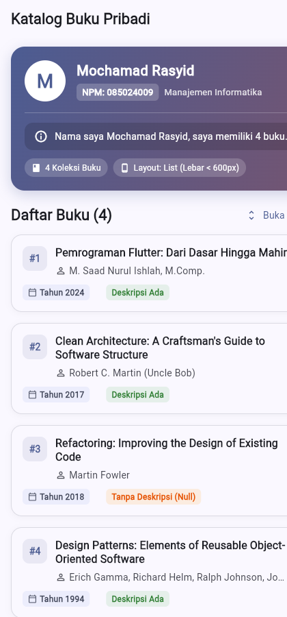
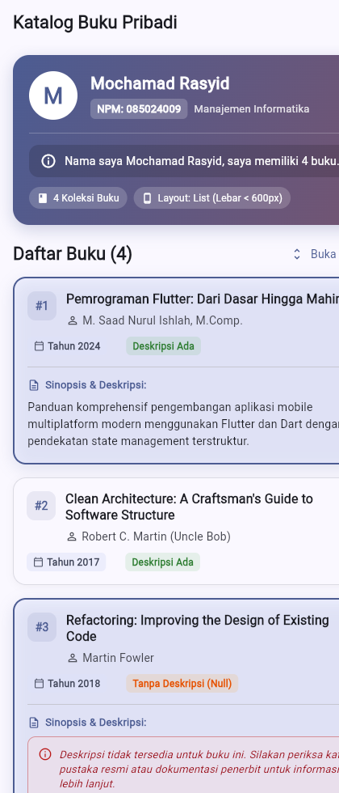
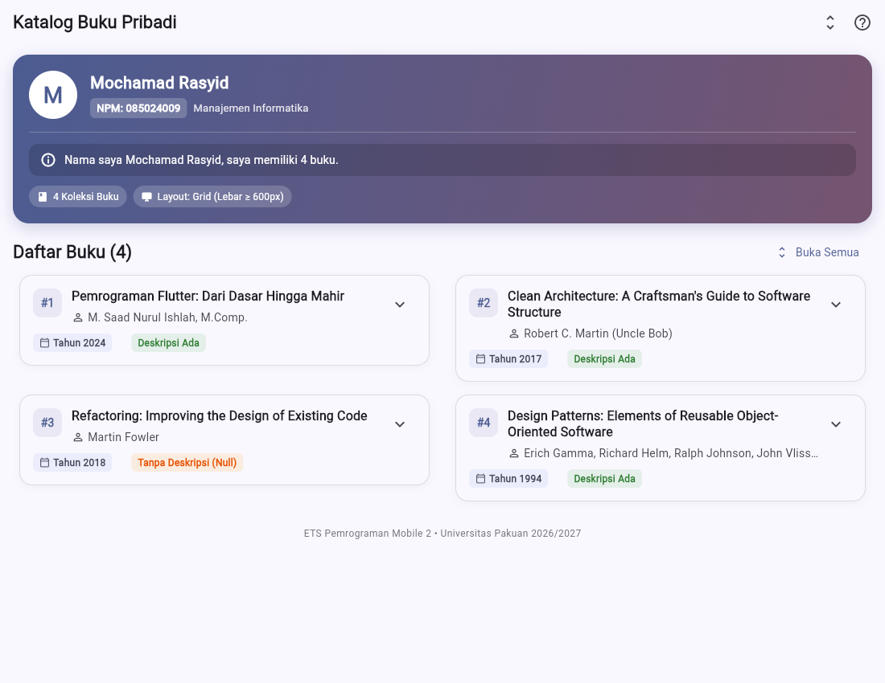

# Evaluasi Tengah Semester (ETS) - Pemrograman Mobile 2
## Aplikasi Katalog Buku Pribadi

Repository ini memuat hasil pengerjaan **Evaluasi Tengah Semester (ETS)** mata kuliah **Pemrograman Mobile 2**, Program Studi D3 Manajemen Informatika, Sekolah Vokasi, Universitas Pakuan (Tahun Akademik 2026/2027).

---

### Identitas Mahasiswa
* **Nama Mahasiswa** : Mochamad Rasyid
* **NPM**            : 085024009
* **Program Studi**  : D3 Manajemen Informatika
* **Dosen Penguji**  : M. Saad Nurul Ishlah, M.Comp. ([@nurulishlah](https://github.com/nurulishlah))
* **Tautan Video**   : [Tonton Video Demonstrasi di YouTube](https://youtu.be/DEMO_ETS_085024009)

---

### Deskripsi Proyek
Aplikasi **Katalog Buku Pribadi** adalah aplikasi mobile multiplatform berbasis Flutter yang menampilkan identitas mahasiswa serta daftar koleksi buku pribadi. Aplikasi ini dibangun dengan menerapkan prinsip *clean code*, *null safety*, tata letak responsif (*responsive layout*), animasi implisit (*implicit animation*), serta arsitektur pengelolaan *state* modern menggunakan **Flutter Riverpod 3**.

---

### Fitur Utama Aplikasi
1. **Model Data & Null Safety Dart (Soal 1)**
   * Class `Book` dengan parameter `required` untuk `id`, `title`, `author`, dan `year`.
   * Atribut `description` bertipe nullable (`String?`), memungkinkan buku tanpa deskripsi tanpa menyebabkan *runtime error*.
   * Koleksi memuat 4 buku, dengan buku ke-3 sengaja bernilai `description: null` untuk pengujian null safety.

2. **Tampilan & Layout Responsif (Soal 2)**
   * Header kartu profil menampilkan Nama Mahasiswa, NPM, dan hasil komputasi *infoProvider*.
   * Teks pengganti informatif (*informative fallback*) saat deskripsi bernilai null.
   * Responsif terhadap ukuran layar menggunakan `LayoutBuilder`:
     * **Mobile (< 600px)**: Tata letak *single-column list* yang nyaman untuk penggunaan satu tangan.
     * **Tablet / Desktop / Landscape (≥ 600px)**: Tata letak *dual-column grid* dinamis (*auto-fit height*).

3. **Pengelolaan State dengan Riverpod 3 (Soal 3)**
   * `nameProvider`: Menyediakan nama mahasiswa (`Mochamad Rasyid`).
   * `npmProvider`: Menyediakan NPM (`085024009`).
   * `booksProvider`: Menyediakan daftar koleksi buku.
   * `infoProvider`: Menggabungkan `nameProvider` dan `booksProvider` menggunakan `ref.watch()`, menghasilkan teks: `"Nama saya Mochamad Rasyid, saya memiliki 4 buku."`.
   * `expandedBooksProvider`: `NotifierProvider` untuk mengelola *state* buku mana saja yang deskripsinya sedang dibuka/tutup, mendukung aksi *Toggle*, *Buka Semua*, dan *Tutup Semua*.

4. **Animasi Implisit yang Halus (Soal 4)**
   * `AnimatedContainer`: Animasi transisi warna latar belakang, ketebalan *border* (1px → 2px primary), dan elevasi bayangan (*box shadow*) kartu saat dibuka.
   * `AnimatedRotation`: Animasi rotasi halus ikon panah chevron sebesar 180° (0.5 turns) saat kartu diperluas.
   * `AnimatedCrossFade`: Animasi transisi membuka/menutup konten deskripsi secara mulus tanpa lonjakan tata letak (*layout jump*).

5. **Arsitektur Kode Berbasis MVVM (Soal 5)**
   * `lib/models/`: Lapisan data model (`book.dart`).
   * `lib/providers/`: Lapisan state management & ViewModel (`book_provider.dart`).
   * `lib/widgets/`: Komponen UI modular (`info_header.dart`, `book_card.dart`).
   * `lib/pages/`: Lapisan antarmuka pengguna View (`catalog_page.dart`).
   * `lib/main.dart`: Titik masuk aplikasi dibungkus dengan `ProviderScope`.

---

### Struktur Direktori Repository
```text
ets-pemrograman-mobile-2-085024009/
├── docs/
│   ├── LAPORAN_ETS_085024009.pdf     # Berkas Laporan Resmi Format PDF
│   └── screenshots/                   # Tangkapan layar antarmuka aplikasi
│       ├── screenshot_mobile.png
│       ├── screenshot_desktop.png
│       └── screenshot_interaction.png
├── lib/
│   ├── main.dart
│   ├── models/
│   │   └── book.dart
│   ├── pages/
│   │   └── catalog_page.dart
│   ├── providers/
│   │   └── book_provider.dart
│   └── widgets/
│       ├── book_card.dart
│       └── info_header.dart
├── test/
│   └── widget_test.dart               # Automated testing (100% Passed)
├── pubspec.yaml
├── pubspec.lock
├── .gitignore
└── README.md
```

---

### Tangkapan Layar Aplikasi
| Mode Mobile (< 600px) | Mode Interaksi & Null Fallback | Mode Desktop / Tablet (≥ 600px) |
| :---: | :---: | :---: |
|  |  |  |

---

### Lingkungan Pengembangan & Versi Flutter
* **Flutter Version** : `3.44.0` (Channel stable)
* **Dart SDK Version**: `3.12.0`
* **Platform Target** : Android, iOS, Web, Windows, macOS, Linux
* **Dependencies Utama**:
  * `flutter_riverpod: ^3.5.0`
  * `cupertino_icons: ^1.0.8`

---

### Langkah Menjalankan Aplikasi
1. **Clone Repository:**
   ```bash
   git clone https://github.com/mochamadrasyid22-design/ets-pemrograman-mobile-2_085024009.git
   cd ets-pemrograman-mobile-2-085024009
   ```

2. **Unduh Dependencies:**
   ```bash
   flutter pub get
   ```

3. **Jalankan Verifikasi Pengujian & Analisis Kode:**
   ```bash
   flutter test
   flutter analyze
   ```

4. **Jalankan Aplikasi:**
   * Untuk menjalankan di emulator/device Android:
     ```bash
     flutter run -d android
     ```
   * Untuk menjalankan di browser Chrome / Web:
     ```bash
     flutter run -d chrome
     ```
   * Untuk menjalankan di desktop Windows:
     ```bash
     flutter run -d windows
     ```

---

### Status Keberfungsian Fitur
| No | Komponen / Fitur | Status |
| :--- | :--- | :---: |
| 1 | Model data `Book` dengan Null Safety | **Berfungsi 100%** |
| 2 | Layout responsif (Mobile List & Tablet Grid) via `LayoutBuilder` | **Berfungsi 100%** |
| 3 | Teks pengganti informatif saat deskripsi null | **Berfungsi 100%** |
| 4 | State Management Riverpod (`nameProvider`, `booksProvider`, `infoProvider`) | **Berfungsi 100%** |
| 5 | Fitur Tampil / Sembunyi Deskripsi (Toggle & Batch Expand/Collapse) | **Berfungsi 100%** |
| 6 | Implicit Animation (`AnimatedContainer`, `AnimatedRotation`, `AnimatedCrossFade`) | **Berfungsi 100%** |
| 7 | Struktur kode terpisah (Model, Provider, Widget, Page) | **Berfungsi 100%** |
| 8 | Laporan lengkap dalam format PDF (`docs/LAPORAN_ETS_085024009.pdf`) | **Tersedia** |

> *Catatan: Seluruh fitur yang dipersyaratkan pada lembar soal ETS telah berfungsi dengan baik tanpa kendala.*

---

### Referensi & Keterangan Penggunaan AI
1. **Referensi:**
   * Dokumentasi Resmi Flutter: [https://docs.flutter.dev](https://docs.flutter.dev)
   * Panduan Null Safety Dart: [https://dart.dev/null-safety](https://dart.dev/null-safety)
   * Dokumentasi Riverpod: [https://riverpod.dev](https://riverpod.dev)
2. **Keterangan Penggunaan AI:**
   * Dalam pengerjaan tugas ini, mahasiswa memanfaatkan bantuan asisten AI (Google Gemini / Antigravity IDE) untuk membantu penyusunan boilerplate arsitektur Riverpod, penataan responsive layout `LayoutBuilder`, dan otomasi pembuatan dokumen PDF.
   * Seluruh kode dan hasil keluaran telah divalidasi, diuji melalui automated test `flutter test`, dan dipahami secara utuh oleh mahasiswa.

---
*Evaluasi Tengah Semester Ganjil 2026/2027 • D3 Manajemen Informatika • Sekolah Vokasi Universitas Pakuan*
